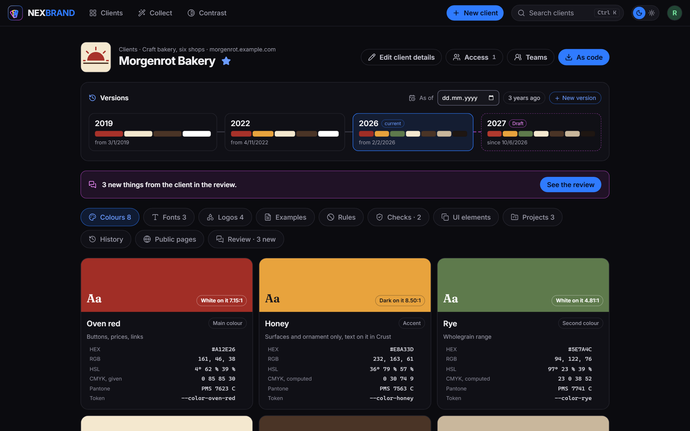
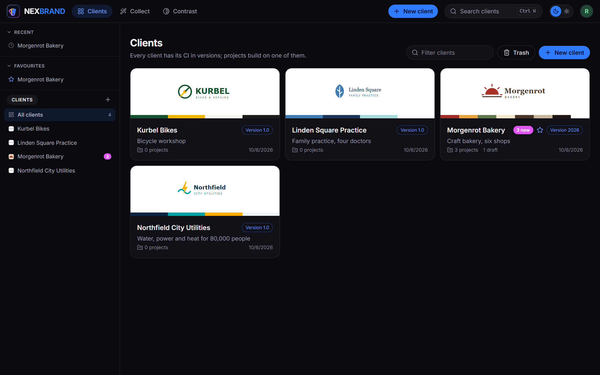
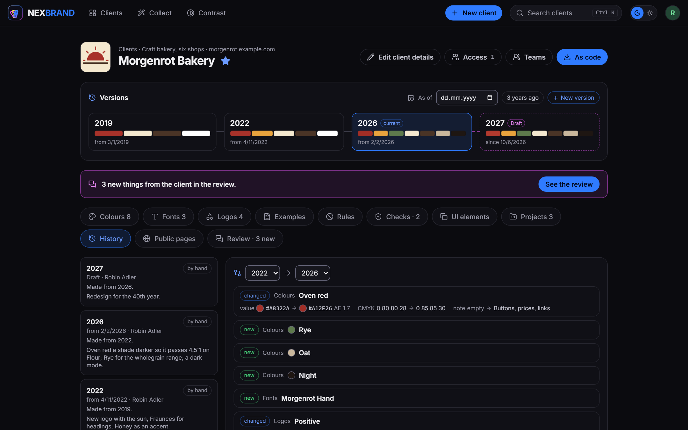
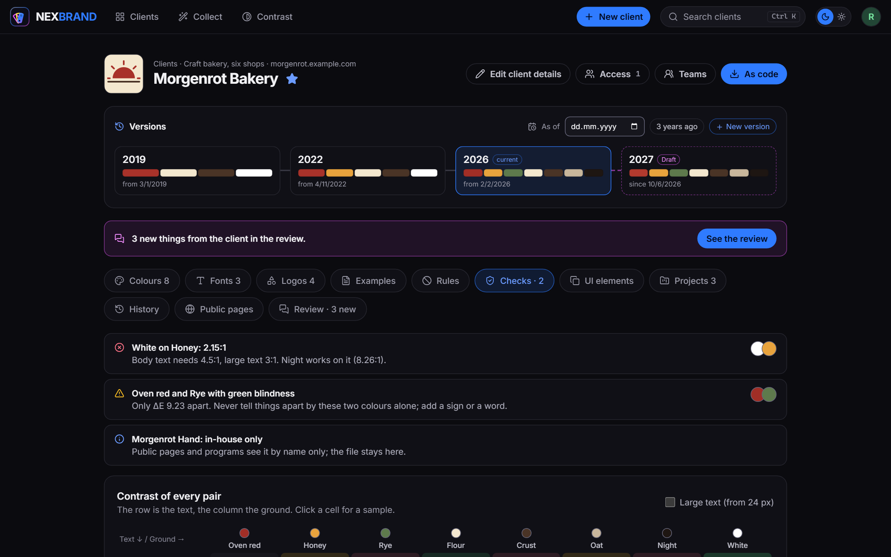
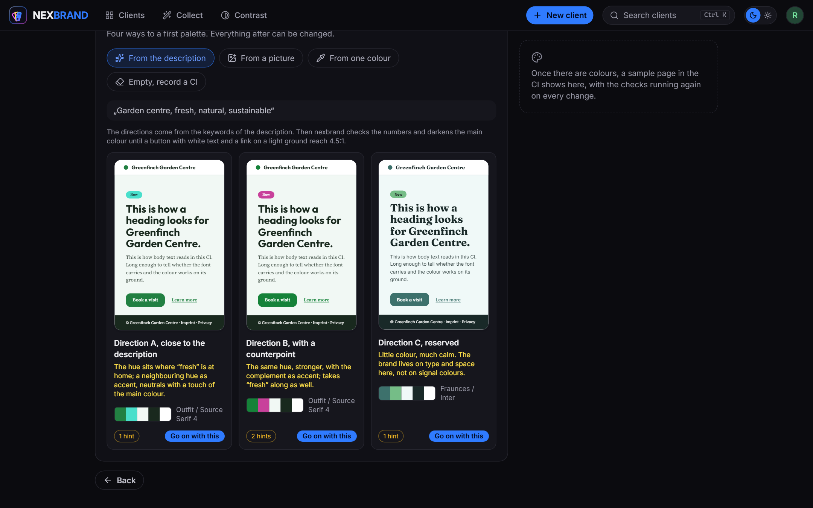
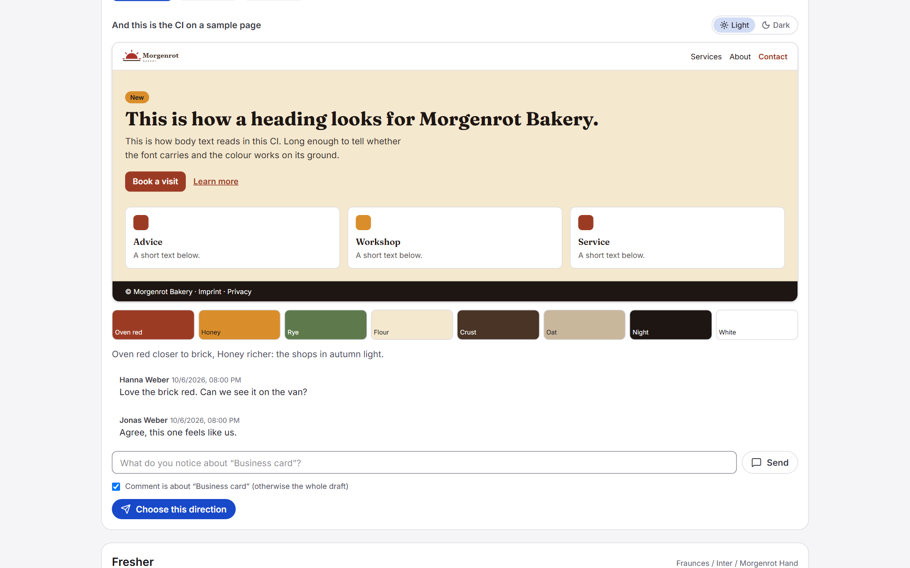
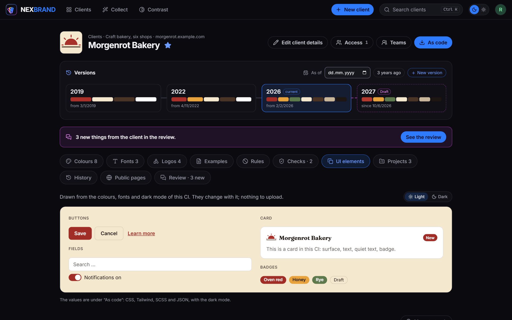
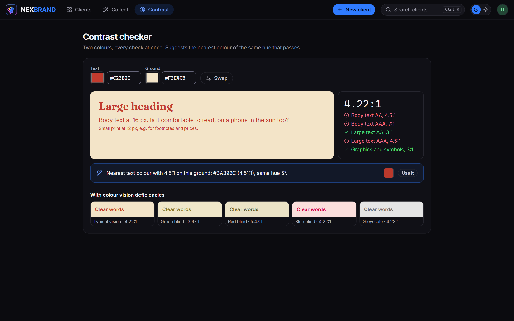
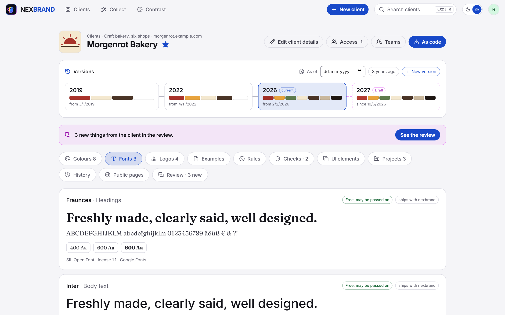
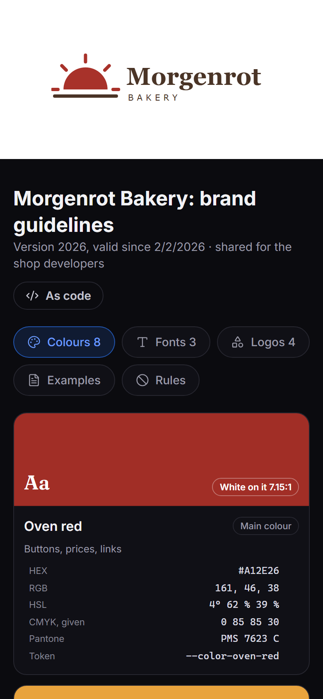

# nexbrand

[](https://www.nexbrand.de)

The corporate design of your clients in one place, on your own server: colours, fonts, logos, type scale, rules and
example files, per client and per project, with every version kept. For agencies, freelancers and developers who build
for several brands.

nexbrand is one of the nex apps and looks like them: cobalt, dark and light. Whoever knows nexlore or nexcanvas finds
the same frame here: accounts, second factor, sign-in through a provider, log, languages and backups. What it can do
and a guide from the first client to the first review are on the project site,
**[www.nexbrand.de](https://www.nexbrand.de)**.

> **Early days.** nexbrand is at its first version. It works and is well tested, but a lot of it is still finding
> its shape, and this is the time when ideas and feedback change the most. What do you keep for your clients today,
> and where? What is missing, what is in the way, what would make you switch? Tell me in an
> [issue](https://github.com/DerKezorm/nexbrand/issues), small or large.



*A client. Its versions on a time line: 2019, 2022, the current 2026 and a draft for 2027 that is before the client,
who has left three comments. Every colour with the text that reads on it, its values for screen and print, and the
name it has in code.*

## Screenshots



*Every client with its logo and colours, the version it is at, its projects and drafts, and what is new from the
client. People and teams get access per client.*



*Two versions side by side: a colour that changed, with its distance (ΔE) and print values, new colours and fonts,
logos that changed. "As of" shows the CI of any day. A project stays on the version it was made with until somebody
moves it, so a reprint looks like the first print.*



*Checks computed from the set, never written by hand: contrast by WCAG 2.2 with the colour of the set that would
work, colours that a colour vision deficiency pulls together, rules the set breaks, fonts that stay in the house.
Below, the contrast of every pair.*



*The workbench for a client without a CI: three directions from a few words, each on a sample page and checked
before anything is chosen. From there colours with harmonies, a font pair and a type scale, while the sample page
and the checks follow every change.*



*The client's side of a review, without an account: the agency's own drafts to leaf through, every direction on a
sample page in light and dark, comments on the whole or on one picture, and a button to choose. The choice becomes
the next version.*

<p>
  
  
</p>

*UI elements drawn from the CI, in its light and its dark mode, and the contrast checker, which proposes the nearest
colour of the same hue that passes.*

<p>
  
  
</p>

*Light and dark, and on the right the public page a developer gets: the design set read only, also as code, without
an account and with an end date.*

## What it does

- **Clients and their design sets.** A client has colours with roles (primary, secondary, accent, neutral) and
  their print values, fonts with their licence, logos with the ground they belong on, a type scale, do's and don'ts,
  and example files. Each colour shows its scale from 50 to 950, contrast with white and dark, RGB, HSL and CMYK.
- **Versions on a time line.** Every change becomes a draft first; publishing freezes it with the day it applies from.
  "As of" shows the design set of any day, "three years ago" is one click. Two versions side by side show what
  changed, colours with their distance, and how the checks changed with them.
- **Projects keep their version.** A project (a website, a reprint, a trade fair) is pinned to the version it was
  made with and may have colours of its own. It moves to a newer version only when somebody moves it, so a reprint
  looks like the original.
- **Checks that are computed, never written by hand.** Contrast of every pair by WCAG 2.2, logos at 3:1 against their
  ground, how the colours look with colour vision deficiencies (Machado 2009), colours nearly the same (CIEDE2000),
  body text too small, fonts that may not leave the house. A contrast calculator proposes the nearest colour of the
  same hue that passes.
- **The workbench for a new CI.** Start from a few words, a picture, one colour or nothing: harmonies, neutrals with a
  touch of the main colour, a font pair, sizes from a base and a ratio. A sample page and the checks run next to it
  while you work. Until a logo exists, a word mark from the name keeps developers going.
- **Review with the client.** A link without an account shows the directions as sample pages; the client comments
  and picks one, and the choice becomes version 1.0. With a mail server set up, nexbrand mails the link as well.
- **Collect from what exists.** A website, a GitHub repository or a PDF style guide provides its colours, fonts and logos.
  The values are always measured; rules or your own AI service sort them. The result is a draft, or a check of a site
  against the CI that finds the nearly right shades and the foreign fonts.
- **As code.** Every version as CSS variables, a Tailwind 4 theme, SCSS or design tokens (JSON), with scales, fonts and
  the type scale with size, line height and weight. Public pages show a design set read only, a fixed version or always the current one, with an end date and a
  password if you like, and hand a developer the same code without an account.
- **For programs and AI tools.** API tokens read design sets over [`/api/v1`](docs/api.md) and over MCP, so an AI in an
  editor builds with the right colours. A token of the level "draft" writes a redesign back, as a draft; publishing
  stays with a person.
- **Your own AI, if you want one.** Each account may enter its own service: a hosted one, Ollama at home, or any
  other with the usual chat interface. It sorts what was collected and proposes directions for a new
  client. Off until the operator allows it; every request is listed word for word for 14 days.
- **Access per client.** People and teams get access to a client, to read, write or manage it; whoever creates a
  client manages it, and the operator decides whether members may create clients. Teams are the operator's; the lead
  of a team changes its members only when the operator allows it (off from the start). A client somebody may not see
  answers like one that does not exist. Clients go to the trash for 30 days.
- **Around it, as in nexlore.** Accounts by invitation (the mail, like the operator's test mail, in the receiver's
  language when an account with that address has one, else in the sender's), blocked and let in again by the operator
  (a blocked account hears so only after its right password; the links it made for clients stay until the operator
  withdraws them), second factor with recovery codes, sign-in through one or more OpenID Connect providers side by
  side, each with its own button (a one-button setup for authentik, or a blueprint to import; Microsoft Entra ID also
  with `common` or `organizations` as the issuer), a log in four levels, German and English plus languages the
  operator adds as JSON files, backups of the database together with every file, with a check before going back.
  An identity at a provider belongs to an account only once that account linked itself under My account, came in by
  invitation, or the operator lets new people in through that provider; an account is never found by its mail
  address. Per provider the operator decides whether it checks the second factor itself.

## Start

```yaml
services:
  nexbrand:
    image: ghcr.io/derkezorm/nexbrand:latest
    container_name: nexbrand
    restart: unless-stopped
    ports:
      - "8540:8000"
    volumes:
      - ./data:/data
    environment:
      PUID: 1000
      PGID: 1000
      TZ: Europe/Berlin
```

```
docker compose up -d
```

Built from source instead: clone this repository, put `build: .` in place of `image:` and run
`docker compose up -d --build`.

Open `http://<your-host>:8540`. The first account you create there is the operator. It needs the **setup code**
from the server's log, so that nobody who reaches a fresh instance first can take it:

```
docker logs nexbrand
```

shows the setup code, new at every start until nexbrand is set up. To choose it yourself, set
`NEXBRAND_SETUP_TOKEN`. `docker-compose.yml` in this repository has the same service with every option explained.

**Put nexbrand behind a reverse proxy with TLS** before you use it from anywhere but your own desk.

## nexbrand on the internet

nexbrand is made to be reachable from outside, for yourself on the road or for a small team. Before you open it:

1. **Set it up first**, from your own network, with the setup code from the log. Only then forward a port.
2. **TLS at a reverse proxy**, and nexbrand reachable only through it: publish the port as `127.0.0.1:8540:8000`
   when the proxy runs on the same host, or keep both on a Docker network without a published port. Send HSTS from
   the proxy.
3. **Tell nexbrand about the proxy**: `NEXBRAND_PUBLIC_URL` (the address people use), `NEXBRAND_TRUSTED_PROXIES`
   (the proxy's address or network; without it every sign-in seems to come from the proxy and the brake against
   guessing cannot tell people apart: a browser that signed in as that name before still gets in, also while
   somebody guesses that very name (until a new password, a block or signing out everywhere), any other waits;
   Settings, Server says so while it is missing), and `NEXBRAND_COOKIE_SECURE: "on"`. A proxy named in
   `NEXBRAND_TRUSTED_PROXIES` is also believed about the scheme (`X-Forwarded-Proto`: that it ended TLS), which the
   return address of the sign-in and the links in mails are built from; nobody else is. The authentik card in
   Settings, Sign-in warns while nexbrand sees `http` where your browser uses `https`.
4. **A second factor**: set up your own under My account, Security. Or sign in through your OpenID Connect provider
   (and leave "The provider checks the second factor itself" on only for one that does).
5. **Leave the switches closed you do not need**: public pages, API tokens, collecting from websites and AI are
   off until you open them.
6. **Optionally keep the operator's settings at home**: `NEXBRAND_OPERATOR_NETWORKS: "192.168.0.0/16"` refuses them
   from anywhere else (behind a proxy only together with `NEXBRAND_TRUSTED_PROXIES`).
7. **Backups somewhere else**: they contain everything, logos, fonts and files included. Copy one off the machine now and
   then, as carefully as the data directory, and try a restore with "Check".
8. **Pin a version** instead of `latest`, update on purpose, back up before.

## Where things are stored

Everything lives in `/data`: the SQLite database `nexbrand.db` (accounts, teams, clients with their access,
versions and projects), `media/` (logos, fonts and example files, the same file stored once), `secret.key`, `backups/`, `logs/`,
`locales/`.
Mount it from a local disk, never from an SMB or NFS share: SQLite's locking does not work reliably over network
filesystems.

Back it up with nexbrand's own backups (Settings, Server, Backup), which copy the database consistently while it
runs and take every file along. A backup is a plain ZIP; whoever has it has everything, so keep
downloaded copies as carefully as the data directory itself.

Moving to a new server: download a backup, set up nexbrand there, upload the backup under Settings, Server,
Backup, check it and restore it. Afterwards the new server has the old accounts, clients, versions and files.

## Updating

With an image: `docker compose pull && docker compose up -d`. Built from source: pull the new code and run
`docker compose up -d --build`. nexbrand adds what the database lacks at the start; nothing needs doing by hand. Make a backup before a big jump anyway.

## Environment

| Variable | Default | Meaning |
|---|---|---|
| `NEXBRAND_DATA_DIR` | `/data` | Database, files, logs, backups, languages |
| `NEXBRAND_MEDIA_DIR` | `<data>/media` | Logos, fonts and example files |
| `NEXBRAND_LOCALES_DIR` | `<data>/locales` | Extra languages, one JSON file each |
| `NEXBRAND_SECRET_KEY` | created on first start | Protects server-side secrets; when set, it wins over `secret.key` |
| `NEXBRAND_PUBLIC_URL` | from the request | The address people use to reach nexbrand, for invitation links, public pages and the OIDC redirect. The setting in the interface wins when set |
| `NEXBRAND_TRUSTED_PROXIES` | none | Addresses or networks of reverse proxies whose `X-Forwarded-For` and `X-Forwarded-Proto` are believed, comma separated |
| `NEXBRAND_SETUP_TOKEN` | created at start | The code the first account needs |
| `NEXBRAND_OPERATOR_NETWORKS` | none | Networks the operator's settings may be changed from, comma separated |
| `NEXBRAND_UPLOAD_MAX_MB` | `50` | The largest file; the operator can lower it in the settings |
| `NEXBRAND_SESSION_DAYS` | `30` | A browser session ends after this many days |
| `NEXBRAND_LOG_LEVEL` | stored setting | `quiet`, `normal`, `detailed` or `trace`; overrides the setting |
| `NEXBRAND_COOKIE_SECURE` | `auto` | `on`, `off` or `auto` (from the request, or `X-Forwarded-Proto` of a proxy in `NEXBRAND_TRUSTED_PROXIES`) |
| `NEXBRAND_API_DOCS` | `false` | Serves `/api/docs` and `/api/openapi.json` |
| `PUID`, `PGID` | `1000` | Owner of the files in the data directory |

## For programs and AI tools

Build pipelines, scripts, nexdeck and AI tools in an editor read design sets with an API token: as JSON, as CSS,
Tailwind, SCSS or design tokens, of any version or day, with a project's own colours. Over MCP an AI checks contrast,
compares versions, audits the colours in code against the CI, and with a draft token writes a redesign back as a
draft. Off until the operator switches it on; every account then creates its own tokens, which see only the clients
chosen and run out after 90 days unless somebody wants more on purpose. Everything is in
[docs/api.md](docs/api.md).

## Security in short

- Passwords are hashed with Argon2id; failed sign-ins lock an account for a while, and a brake per sender slows
  guessing on top. With a second factor, the password alone opens nothing. A lock from guessing leaves the account's
  API tokens working, so nobody switches a program off with ten wrong passwords.
- Every changing request needs the header `X-Nexbrand-Client`, which a page on another site cannot send.
- A client somebody may not see answers exactly like one that does not exist, in every route.
- A published version never changes; drafts from tokens or collecting stay drafts until a person publishes them. One
  published to apply from a later day applies from that day on, in the app, the code and the API alike.
- Fonts marked internal never leave as a file: not on public pages, not through a token or MCP, not as an example
  or a logo download either.
- The links of public pages and reviews are keys: from the right to write for a client up a person sees, copies and
  creates them; readers only see that there are some.
- Collecting fetches only public addresses, resolved and checked by nexbrand itself, every redirect again, with size
  limits; a key for GitHub never follows a redirect to another host. An AI service in the own network needs the operator to name its host.
- Files are served with their own sandboxing policy; whatever a browser would not show by itself is a download.
  SVG logos are shown as pictures, never as pages, and an SVG with a script, an event attribute, a `javascript:`
  address, embedded HTML or a DOCTYPE is refused on upload. A picture's pixels are counted before it is decoded.
- Deleting a client for good takes the own password, as do the operator's acts on other accounts.
- After signing in, nexbrand only ever sends the browser to one of its own pages, never to another address.
- The log never contains a client's design, passwords, keys or tokens.
- Names and titles contain no control characters, wherever they come from, and every answer asks search engines
  not to index it, the public pages too.

## Development

```
cd backend && python -m venv .venv && .venv/Scripts/python -m pip install -r requirements-dev.txt
.venv/Scripts/python -m uvicorn app.main:app --port 8540
cd frontend && npm ci && npx vite
```

On Linux the virtual environment's programs are in `.venv/bin`. The frontend on port 5540 sends `/api` to the
backend. Tests: `python -m pytest -q` in `backend`, `npx vitest run` in `frontend`.

## License

AGPL-3.0.

The buttons use the [Lucide](https://lucide.dev) icons (ISC, partly MIT from Feather); their notice is in
`frontend/public/licenses/lucide.txt` and ships with the app at `/licenses/lucide.txt`. The nine fonts of the
workbench's catalog are under the SIL Open Font License, their notice at `/licenses/fonts.txt`. Everything else nexbrand ships or depends on, with its licence, is listed in
[THIRD-PARTY.md](THIRD-PARTY.md).
